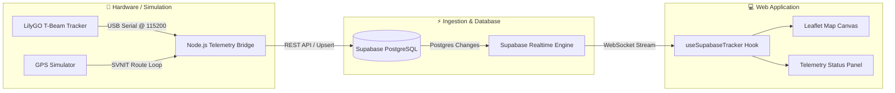

# RideRadar V1 🛰️🚌
> **Real-Time Public Transit Telemetry & Tracking Platform**  
> Powered by LilyGO T-Beam GPS, Node.js Serial Telemetry Bridge, Supabase Realtime, and a high-performance React + Leaflet frontend.

---

## 🌟 Overview

**RideRadar** is an end-to-end real-time GPS tracking solution designed for public transit networks (such as the Surat BRTS Sitilink network). It captures live telemetry directly from GPS tracker hardware (or route simulation), streams data into Supabase, and renders real-time location, speed, satellite lock, and movement on an interactive map.

---

## ⚡ Key Features

- 🛰️ **Hardware & Simulator Ready**: Seamlessly ingests GPS coordinates from physical **LilyGO T-Beam (ESP32)** trackers via USB Serial (`115200` baud) or runs in mock simulation mode.
- ⚡ **Supabase Realtime Sync**: PostgreSQL WebSocket publications broadcast GPS updates instantly to connected clients with sub-second latency.
- 🗺️ **Interactive Live Map**: Built with **Leaflet** & OpenStreetMap, featuring:
  - Custom pulsing radar location pin.
  - Smooth camera panning as coordinates update.
  - Informative click popups with device ID, speed, coordinates, and satellite count.
- 📊 **Telemetry Dashboard**:
  - Live status indicator (`LIVE`, `CONNECTING`, `OFFLINE`).
  - Real-time speedometer (`km/h`) and satellite lock counter.
  - Automatic stale detection (marks offline if updates cease).
- 📱 **Responsive UI**: Built with modern CSS design system, dark-mode ready, fully responsive across desktop, tablet, and mobile.

---

## 🏗️ Architecture



---

## 📂 Project Structure

```text
Rideradar_V1/
├── backend/
│   ├── .env.example          # Environment variables template
│   ├── index.js              # Hardware serial bridge & GPS simulator
│   └── package.json          # SerialPort, Axios, Dotenv dependencies
├── frontend/
│   ├── .env.example          # Frontend Supabase keys template
│   ├── src/
│   │   ├── components/       # TrackerMap, TrackerPanel, AppShell
│   │   ├── hooks/            # useSupabaseTracker (Realtime hook)
│   │   ├── lib/              # Supabase JS client configuration
│   │   ├── routes/           # TanStack Router page views
│   │   ├── styles.css        # Modern design system & radar animation
│   │   └── types/            # Telemetry type definitions
│   ├── package.json          # React 19, Leaflet, TanStack Start
│   └── vite.config.ts        # Vite configuration
├── package.json              # Root concurrent dev runner scripts
├── supabase_setup.sql        # Database schema, RLS policies & Realtime trigger
└── README.md
```

---

## 🚀 Quick Start Guide

### Prerequisites
- [Node.js](https://nodejs.org/) (v18.0.0 or higher)
- [Git](https://git-scm.com/)

### 1. Clone the Repository
```bash
git clone https://github.com/shivammishra471201-ctrl/ridradar.git
cd ridradar
```

### 2. Install Dependencies
Run in root directory:
```bash
npm install
npm install --prefix backend
npm install --prefix frontend
```

### 3. Configure Environment Variables

Create `.env` inside **`backend/`**:
```env
SUPABASE_URL=https://<your-project-ref>.supabase.co/rest/v1/buses
SUPABASE_SERVICE_KEY=your_supabase_service_role_key
COM_PORT=COM4
BAUD_RATE=115200
SIMULATE=true
```

Create `.env` inside **`frontend/`**:
```env
VITE_SUPABASE_URL=https://<your-project-ref>.supabase.co
VITE_SUPABASE_ANON_KEY=your_supabase_anon_public_key
```

### 4. Setup Supabase Database
1. Open your Supabase project's **SQL Editor**.
2. Run the SQL script from [`supabase_setup.sql`](./supabase_setup.sql).
3. This creates the `buses` table, enables Row Level Security (RLS), adds Realtime publication, and seeds starter telemetry.

---

## 🏃 Running the Application

### Mode A: Local Simulation (No physical hardware needed)
Runs the GPS route simulator (SVNIT Campus, Surat) and the frontend together:
```bash
npm.cmd run mock
```
Then open **`http://localhost:8080`** in your browser.

### Mode B: Real Hardware (LilyGO T-Beam GPS)
1. Plug your LilyGO T-Beam into your computer via USB.
2. In `backend/.env`, set `COM_PORT` to your device's port (e.g. `COM3` on Windows or `/dev/ttyUSB0` on Linux/Mac) and `SIMULATE=false`.
3. Start the system:
   ```bash
   npm.cmd run dev
   ```

---

## 📡 Hardware Payload Formats

The backend serial listener accepts any of the following serial output formats at **115200 baud**:

- **Tagged Format (Recommended):**
  ```text
  LAT:21.164800,LNG:72.784500,SAT:9,SPEED:25.4
  ```
- **CSV Format:**
  ```text
  21.164800,72.784500,25.4,9
  ```
- **JSON Format:**
  ```json
  {"lat": 21.1648, "lng": 72.7845, "speed": 25.4, "satellites": 9}
  ```

---

## 🛡️ License

This project is licensed under the [ISC License](LICENSE).
